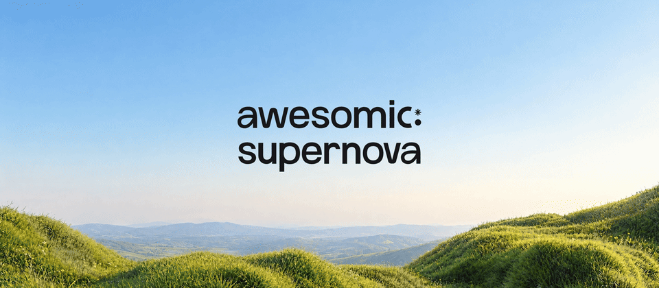
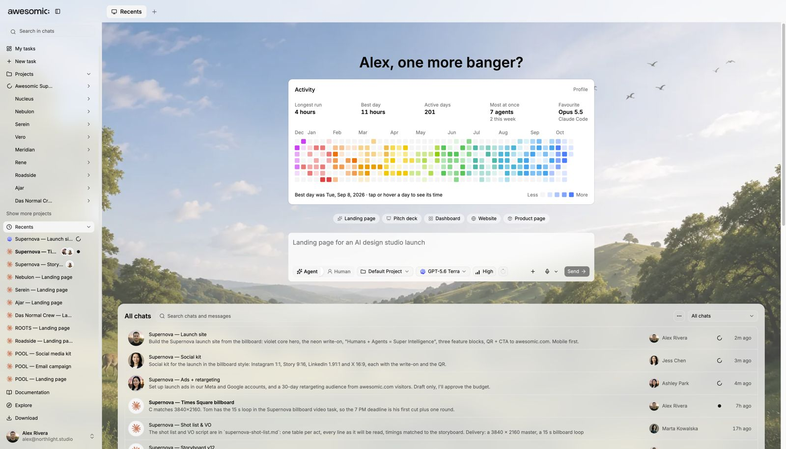
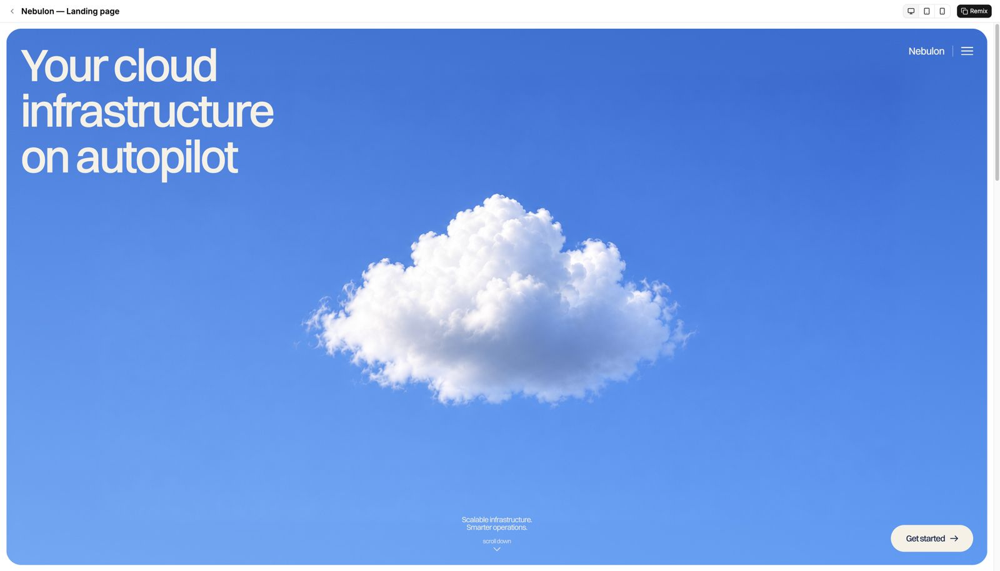
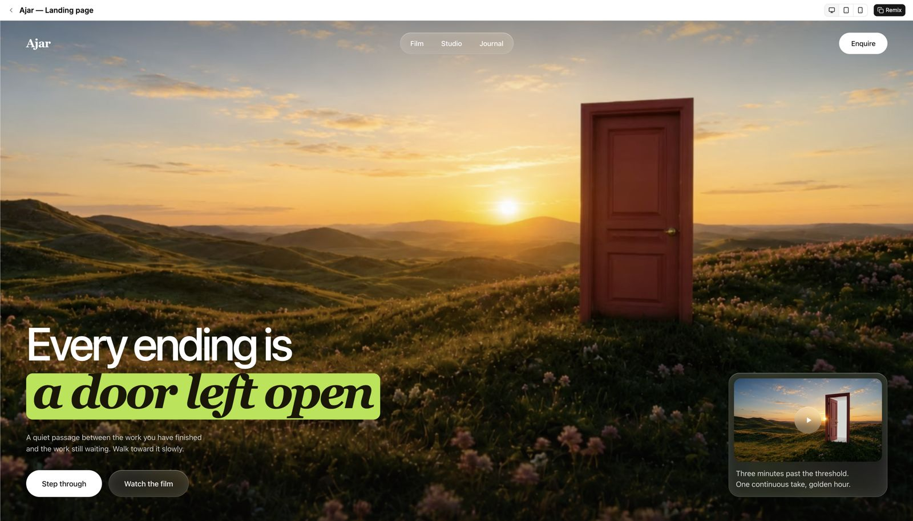

<h3>Agents + Humans = Super Intelligence</h3>

One place to manage intelligence — human and AI — for you or your whole team. Make sites, decks, apps, ads and videos. From your laptop or your phone.

  
  
  
   
  
  
  

  <a href="https://awesomic.com">Website</a> ·
  <a href="#-what-you-get">Features</a> ·
  <a href="docs/README.md">Docs</a> ·
  <a href="https://github.com/awesomic/awesomic/issues/new/choose">Report a bug</a> ·
  <a href="ROADMAP.md">Roadmap</a> ·
  <a href="CONTRIBUTING.md">Contributing</a>

 

> **TL;DR** One app where **AI agents and people** make sites, decks, apps, ads and videos together.

## 🔥 Sound familiar?

It's 7 PM. A client texts: *"need the Times Square ad tonight. + site + ads??"*

- 😩 **Ten AI tabs** open. None talk to each other.
- 🧩 Every tool wants **its own setup**.
- 🧑‍🤝‍🧑 Your team **can't see** what the AI did.
- ⏳ The AI **stops** when you close your laptop.
- 🎨 Some things still need a **real pro**.

**Awesomic fixes all of that in one app.**

## 🚀 Steps: get started in 60 seconds

1. **Download** the app above. Or open it in your browser.
2. **Type what you need.** *"Landing page + launch ads for my app."*
3. **Watch agents work.** Invite your team. Ship it.

New here? Read [Start your first generation](docs/guides/first-generation.md).

## ✨ What you get

| | The pain | How Awesomic fixes it |
|:---:|---|---|
| 🤖 | "Which AI is best for this?" | **Any agent, any model.** Pick per task. |
| ☁️ | "It stopped when I closed my laptop." | **A cloud computer per project.** Always on. |
| 👥 | "My team can't see the AI work." | **One shared chat** for team and agents. |
| ✅ | "Too many things to track." | **One task board** for agents and people. |
| 🔌 | "I still do the boring part." | **1000+ apps.** Agents work inside your tools. |
| 🎯 | "It needs a human touch." | **Top experts on demand.** |
| 📱 | "I'm not at my desk." | **Phone, desktop, web.** |

### 🤖 Any agent. Any model.

- Use **Claude, ChatGPT / Codex, Cursor, Claude Code** or your own MCP.
- Big job? A lead agent splits it across a **team of agents**.

→ [Docs](docs/features/agents-and-models.md)

### ☁️ Your project runs in the cloud

- Every project gets **its own computer**. Up to 1 TB.
- Close your laptop. **Work keeps going.**

→ [Docs](docs/features/projects-and-cloud-computer.md)

### 👥 Team and agents, in one chat

- Share a project with a link.
- Everyone talks to the **same agents** in the **same chat**.

→ [Docs](docs/features/team-and-experts.md)

### ✅ Every task on one board

- Agents and people on **one board**.
- See what's running, done, or waiting on you.

→ [Docs](docs/features/tasks.md)

### 🔌 1000+ apps

- Connect GitHub, Slack, Google, ad accounts and more.
- Agents work **inside** your tools.

→ [Docs](docs/features/apps-and-integrations.md)

### 👀 Preview and publish

- Live preview next to the chat. Comment on the page.
- **Publish** in one click.

→ [Docs](docs/features/preview-and-publish.md)

### 🎯 Top experts, when it matters

- Need a human finish? Add an **Awesomic expert**.
- Top 0.82% of talent. Matched in 24 hours.

→ [Docs](docs/features/team-and-experts.md)

### 📱 Start on your phone

- Same project on **phone, desktop and web**.

→ [Docs](docs/features/mobile.md)

## 🖼️ Made with Awesomic

<table>
  <tr>
    <td width="50%"> <b>Nebulon</b> · landing page</td>
    <td width="50%"> <b>Ajar</b> · landing page</td>
  </tr>
</table>

📚 **All docs:** [docs/README.md](docs/README.md) · Features: [docs/features](docs/features/README.md) · What's new: [CHANGELOG.md](CHANGELOG.md)

## ❓ FAQ

<b>How much does it cost?</b>

 
See plans and pricing at <a href="https://awesomic.com">awesomic.com</a>.

<b>Which AI models can I use?</b>

 
Claude, GPT, Gemini, Grok and more. You can also connect Claude Code, Codex, Cursor or your own MCP server.

<b>Do I need to install anything for my project?</b>

 
No. Each project runs on its own cloud computer. Agents install what they need there.

<b>When is the source code coming?</b>

 
November 2026, after a final security review. Star and watch this repo to get notified.

<b>Can I send a pull request?</b>

 
Not yet — PRs close automatically until the code is public. Issues are very welcome. See <a href="CONTRIBUTING.md">CONTRIBUTING.md</a>.

## 🐞 Found a bug?

**Please tell us.** Issues are open.

1. [Open a bug report](https://github.com/awesomic/awesomic/issues/new?template=bug_report.yml).
2. Say what you did and what went wrong.
3. **Add a screenshot** if you can. It helps a lot.

🔒 Security issue? Don't post it publicly. See [SECURITY.md](SECURITY.md).

## 🧑‍💻 Source code

- The code comes here in **November 2026**, after a final security review.
- 👀 **Watch** this repo to get notified.
- ⭐ Like Awesomic? A **star** helps a lot.

How to help until then: [CONTRIBUTING.md](CONTRIBUTING.md).

---

**Next:** [Read the docs](docs/README.md)

**Agents + Humans = Super Intelligence**

[awesomic.com](https://awesomic.com) · [We're hiring](https://www.awesomic.com/hiring)

