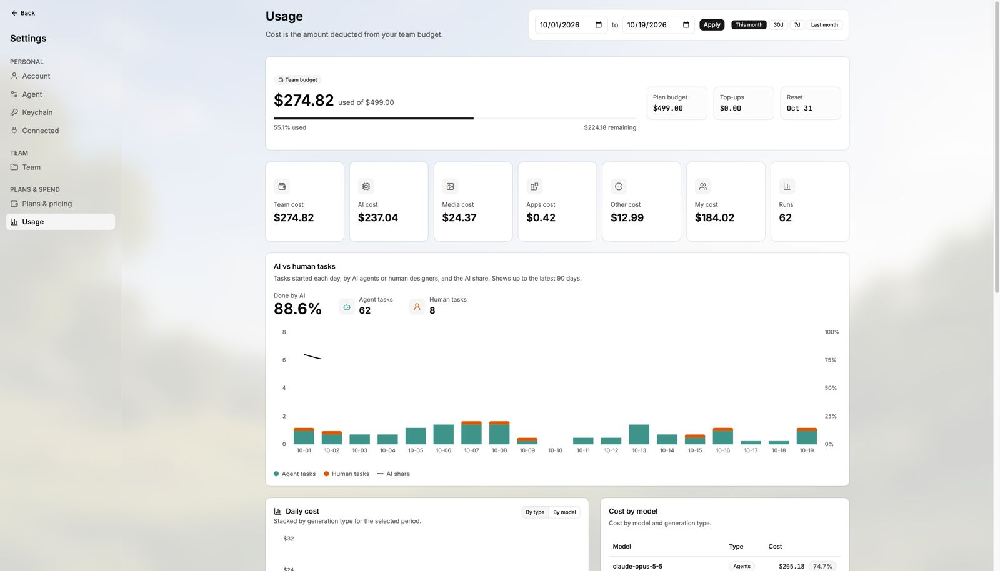
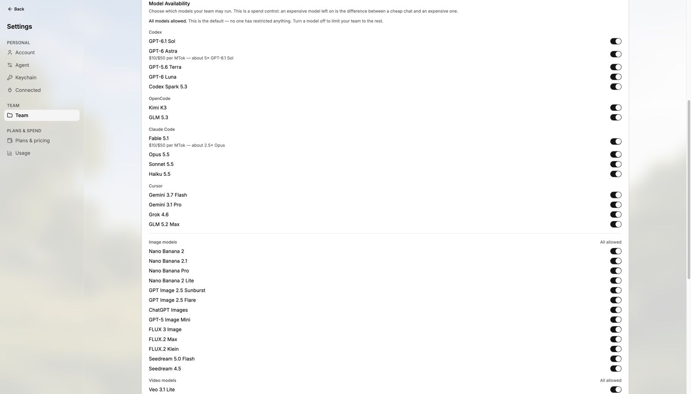

# Admin and usage

> **TL;DR** Admins see **where the money goes** and control **budgets** and **models**.

## Steps

1. Open **Settings → Usage**.
2. See the **team budget** and cost **per person** and **per model**.
3. Set **spending limits**.
4. Choose which **models** your team can use.

## Good to know

- Bring-your-own **Claude or Codex plans** are managed in Settings.
- So are **custom MCP servers**.
- More: [Plans and credits](../guides/plans-and-credits.md).

## Screenshots

---

**Next:** [Awesomic docs](../README.md)
