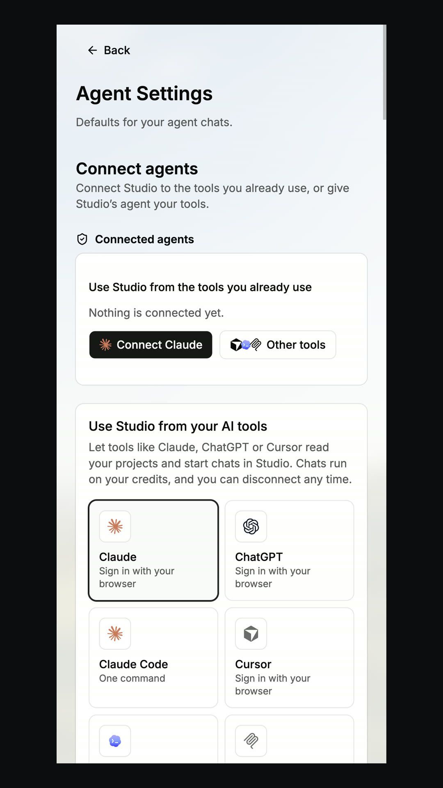

# Chat with any agent and model

> **TL;DR** Ask in plain words. Pick **any agent** and **any model** for each task.

## Steps

1. Write what you need in **plain words**.
2. Pick a **model**: Claude, GPT, Gemini, Grok and more.
3. Or connect the agent you already use: **Claude, ChatGPT, Cursor or Claude Code**.
4. The agent makes a **plan**, does the work, and shows the result next to the chat.

## Good to know

- Each person can **bring their own Claude or Codex plan**. It covers the chats they start.
- This is **optional**.
- You can also use Awesomic **from ChatGPT and Cursor**.

## Screenshots

---

**Next:** [Team and experts](team-and-experts.md)
