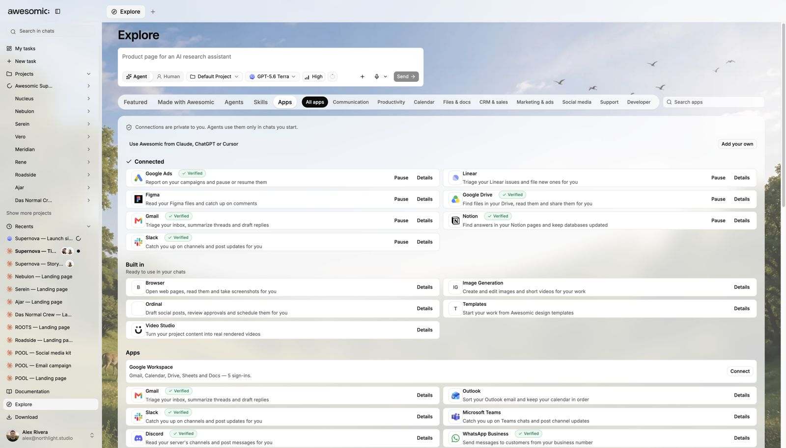
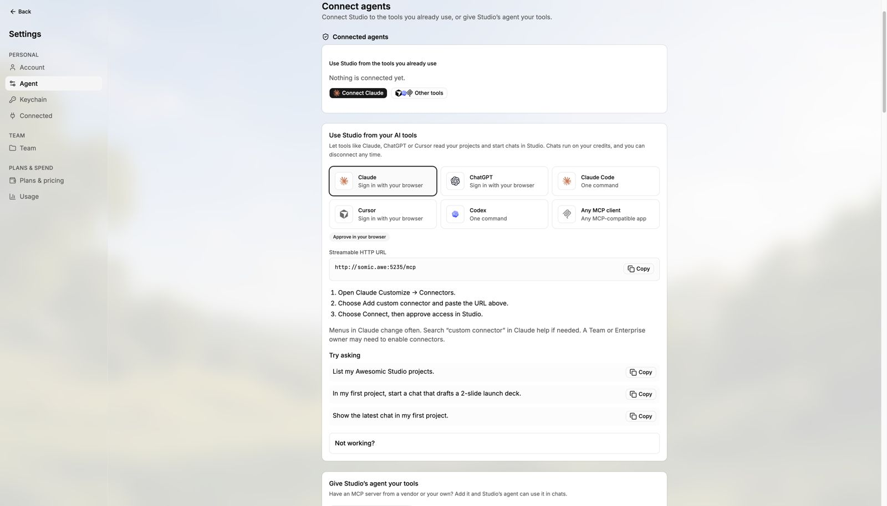

# Apps, integrations and MCP

> **TL;DR** Agents use **1000+ apps** inside your tools. Connect once, use in every chat.

## Steps

1. Open **Explore → Apps**.
2. Connect an app once: Google Drive, Slack, Notion, Figma, Gmail, Linear, Google Ads and more.
3. Working in code? Connect **GitHub**.
4. Admins can add their **own MCP server** in **Settings → Agent**.

## Good to know

- More: [Apps and tools](../guides/apps-and-tools.md).

## Screenshots

---

**Next:** [Explore and skills](explore-and-skills.md)
