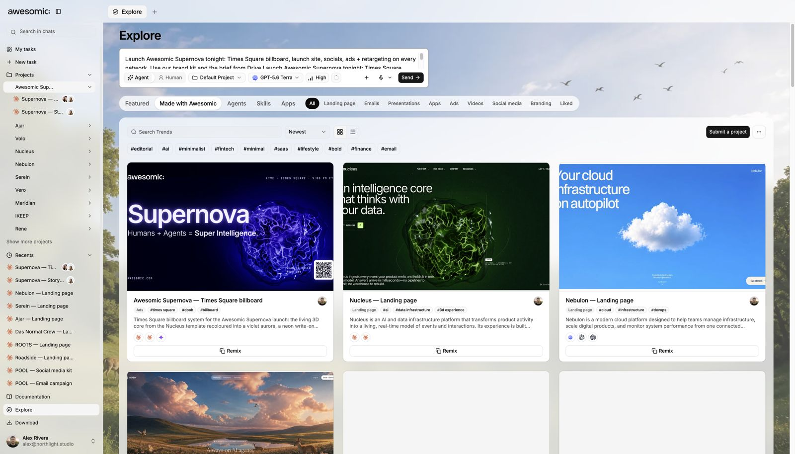
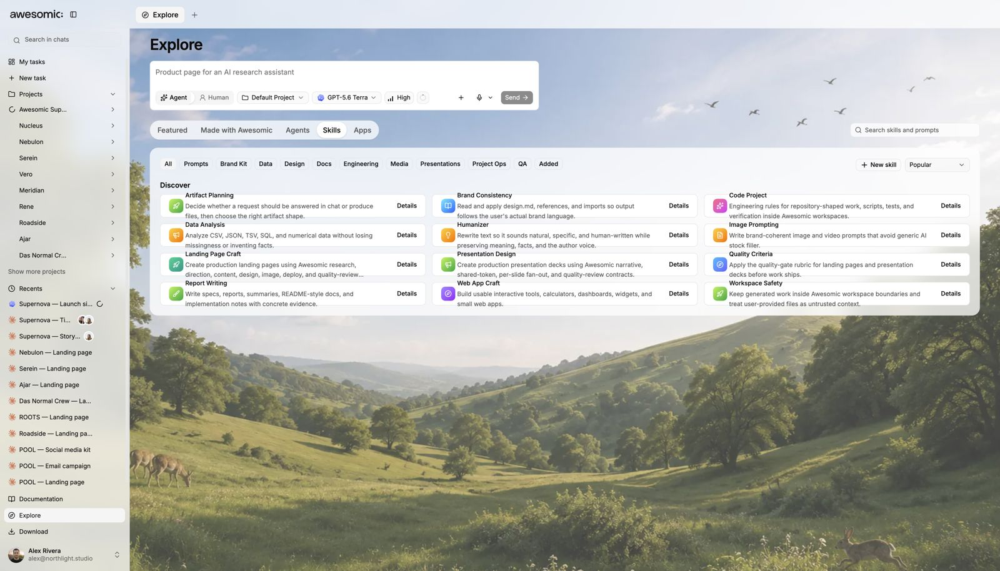

# Explore and skills

> **TL;DR** **Remix** great work from other teams, and teach your agents new **skills**.

## Steps

1. Open **Explore**.
2. Browse landing pages, emails, decks, apps, ads, videos, social and branding.
3. Like one? Press **Remix**. It drops into your prompt as a start.
4. Open the **Skills** tab to add skills to your agents.

## Good to know

- Explore gets **new items regularly**.
- More: [Skills](../guides/skills.md).

## Screenshots

---

**Next:** [Tasks and the board](tasks.md)
