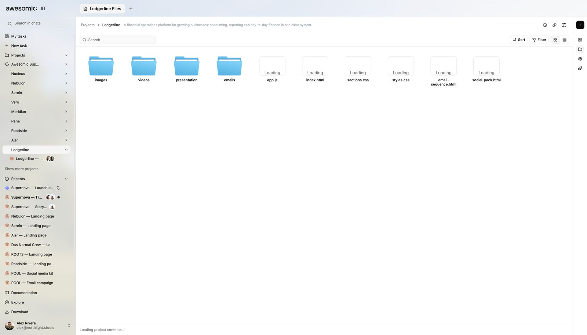

# Files and brand

> **TL;DR** Everything agents make lands in **project files**, next to your **brand rules**.

## Steps

1. Open the project **Files**.
2. Add your brand rules, for example a `DESIGN.md` file.
3. Ask for work. Every agent follows **your style**.
4. One brief can make a **whole set**: site, deck, emails, social posts.

## Good to know

- Files hold **images, video, code, presentations and emails**.
- More: [Add brand context](../guides/brand-context.md).

## Screenshots

---

**Next:** [Apps, integrations and MCP](apps-and-integrations.md)
