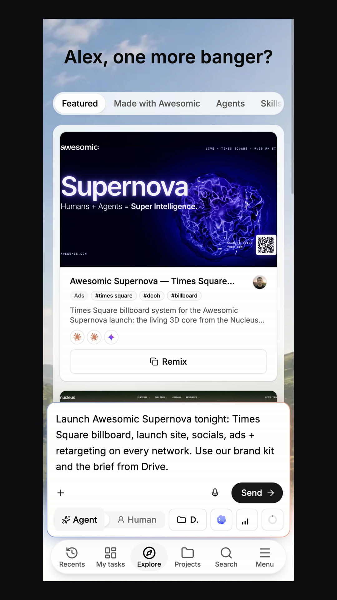
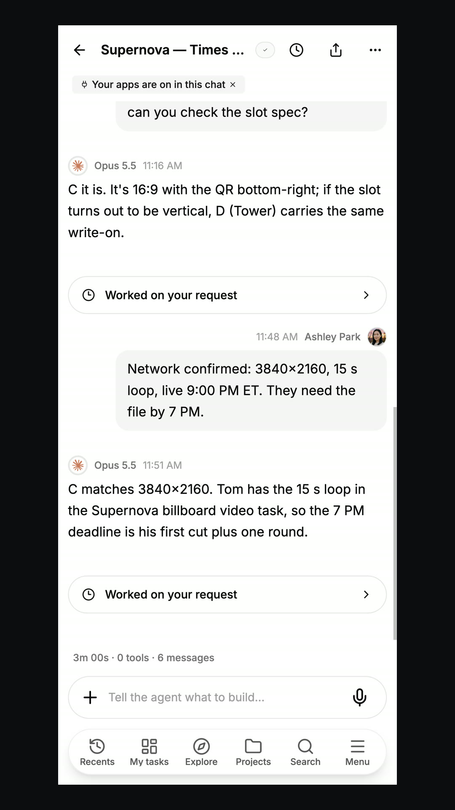
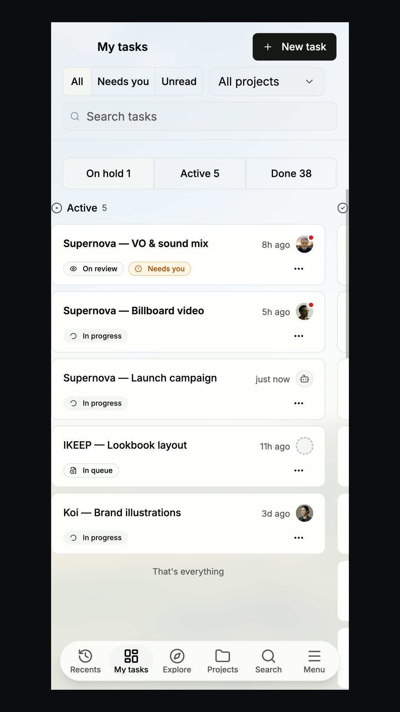
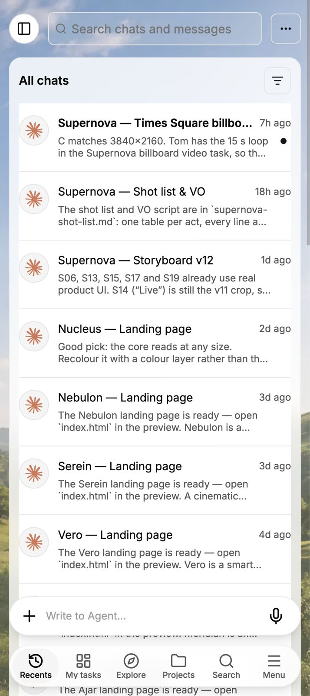

# Mobile

> **TL;DR** The **same project** is on your phone. Start there, finish anywhere.

## Steps

1. Write a **prompt** on your phone.
2. **Answer** the agent, check an **expert update**, or **sign off** on a task.
3. Continue on your **desktop**. Same project.

## Good to know

- The project runs on a **cloud computer**.
- Work **does not stop** when your phone is locked.

## Screenshots

---

**Next:** [Admin and usage](admin-and-usage.md)
