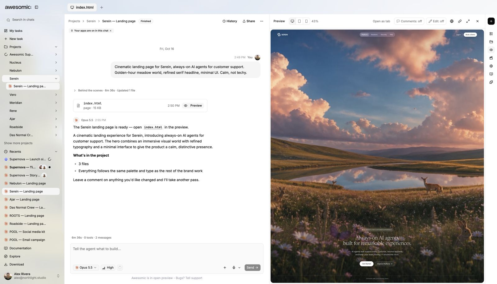

# Preview, comment and publish

> **TL;DR** See the page **live** next to the chat, **pin comments**, then **publish** in one click.

## Steps

1. An agent builds a page. It shows in **Preview**, next to the chat.
2. Want a change? **Say so**, or **pin a comment** on the page.
3. Send the comment to the chat in **one click**.
4. Ready? **Share** a preview link or **publish** the site.

## Good to know

- **History** lets you jump back to any step of the chat.
- Details: [Publish a site](../guides/publish-sites.md).

## Screenshots

---

**Next:** [Files and brand](files-and-brand.md)
