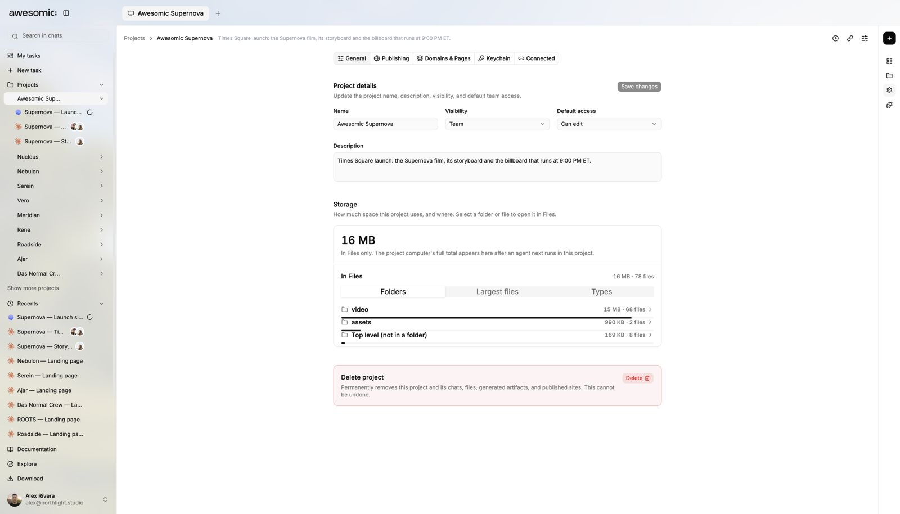

# Projects and the cloud computer

> **TL;DR** Every project runs on its **own always-on computer** in the cloud.

## Steps

1. Create or open a **project**.
2. Ask an agent to work. It can **install and run real programs** there.
3. Close your laptop. **Work keeps going.**
4. Invite a teammate. They open the project and **pick up where you left off**.

## Good to know

- Each project has room for **up to 1 TB** of storage.
- See it in project **Settings → Storage**.
- Teammates **install nothing**. Same files, same computer.

## Screenshots

---

**Next:** [Chat with any agent and model](agents-and-models.md)
