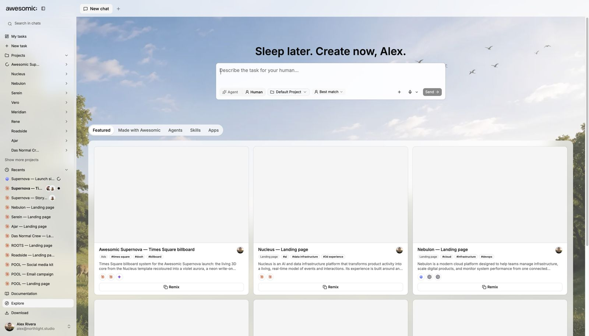
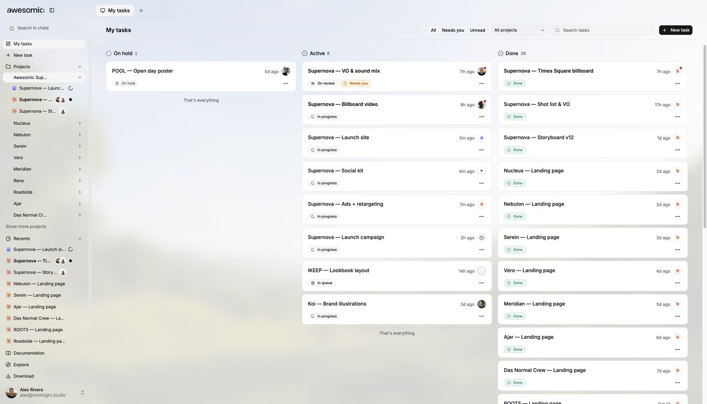
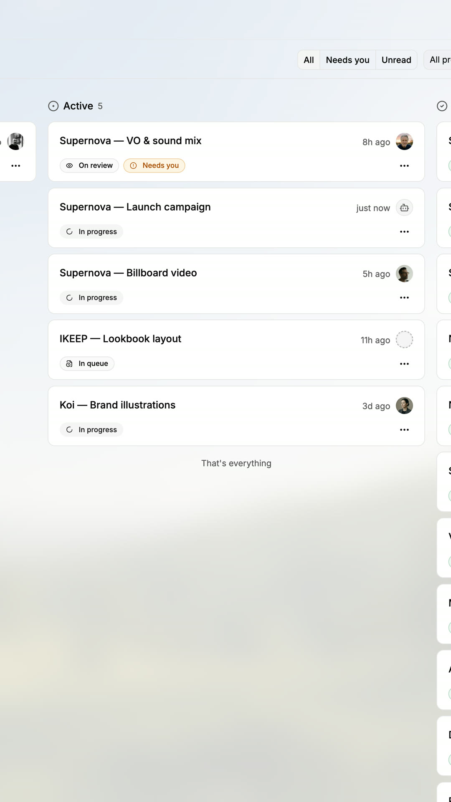

# Tasks and the board

> **TL;DR** Give any task to an **agent** or an **expert**. Track all of them on **one board**.

## Steps

1. Create a task.
2. Switch between **Agent** and **Human**. Awesomic suggests the **best match**.
3. Open the **board**. See what is **active**, **waiting for review** and **done**.
4. Need repeat work, like weekly posts? **Schedule** it.

## Good to know

- Assigning tasks to a **teammate** is being added now.
- More: [Scheduled runs](../guides/scheduled-runs.md).

## Screenshots

---

**Next:** [Mobile](mobile.md)
