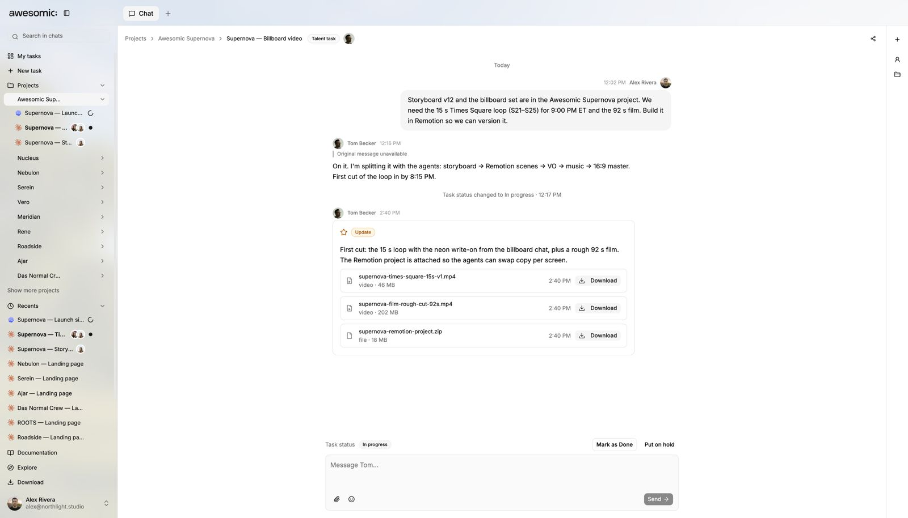

# Team and experts

> **TL;DR** Teammates, agents and **vetted experts** work in the **same project and chat**.

## Steps

1. **Share** a project with a link.
2. Everyone talks to the **same agents** in the **same chat**.
3. Need a person? Hand the job to an **Awesomic expert**.
4. The expert works **inside your project** and posts updates and files there.

## Good to know

- Per awesomic.com, experts are the **top 0.82%** of applicants.
- They are matched **within 24 hours**.
- Trusted by **4,000+ companies**.

## Screenshots

---

**Next:** [Preview, comment and publish](preview-and-publish.md)
