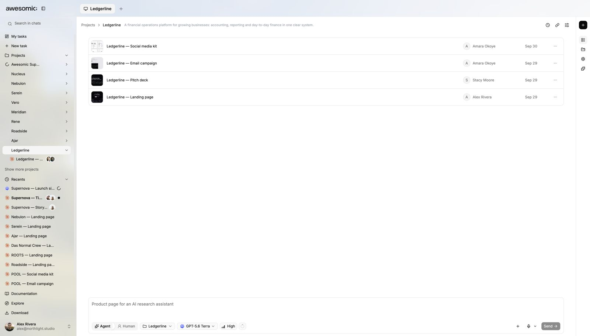

# Add brand context

> **TL;DR** Give the agent your **brand rules**, references and assets so every result looks like you.

## Steps

1. Collect the **source of truth**: visual rules, references, assets, audience, voice.
2. List what **must not change**.
3. Split **firm rules** from **inspiration**.
4. Point the task to the **right project files**.
5. Review the result. Ask which references guided key choices.

## What you get

- Work that follows your brand direction.
- The task can explain **which references** it used.

## If the result drifts

- Name the **exact mismatch**.
- Restate the **rule** that controls it.
- **Replace** conflicting references. Do not add more vague wishes.

## Good to know

- Only add assets you are **allowed to use**.
- Remove **secrets** and unrelated customer material first.

---

**Next:** [Create a landing page](create-landing-page.md)
