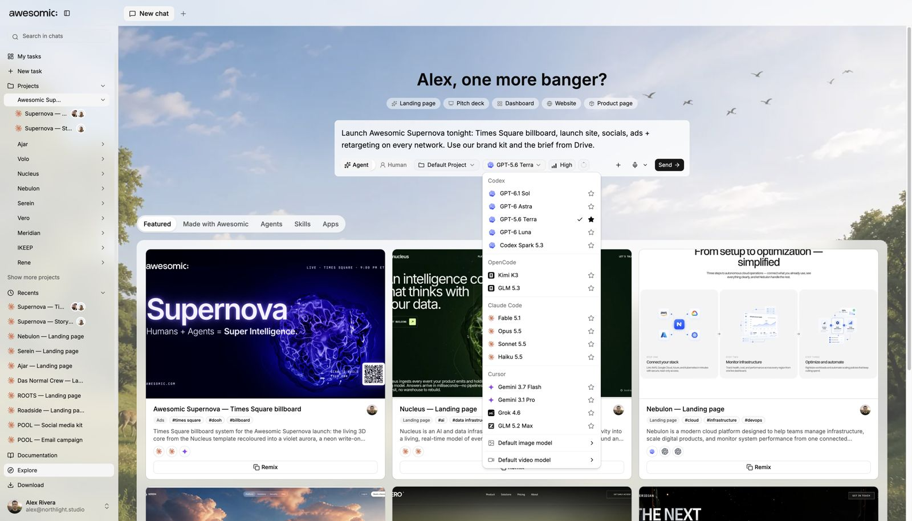

# Capabilities, models and limits

> **TL;DR** Your **request**, **model**, **account**, **context** and **tools** together decide what a task can do.

## Steps

1. Describe the **outcome**. Awesomic picks relevant **capabilities**.
2. Choose a **model**. It and the **tools** shape what can run.
3. Check **account state**. It can limit models or actions.
4. Big or vague job? **Split** it into smaller stages.
5. Review progress, missing requirements and outputs.

## If something goes wrong

- Model or tool **unavailable**? Pick another, or meet the named account or connection need.
- Split big work by **independent outcome**, not by file count.

## Good to know

- Docs describe **supported behaviour**, not access for every account.
- Awesomic should say when a fact is **unknown**. It should not confirm undocumented features.

---

**Next:** [Features](../features/README.md)
