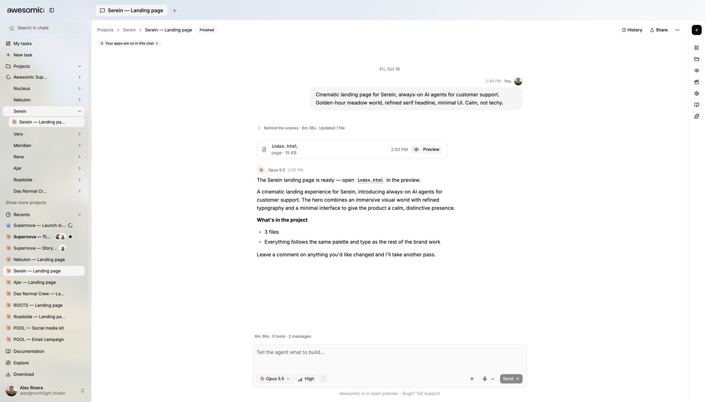

# Create a landing page

> **TL;DR** Pick **Landing page** or write your own brief, press **Send**, then refine in chat.

## Steps

1. Open **New task**.
2. Click **Landing page** to fill the prompt box. Or write your own brief.
3. Edit the brief. Check the **project** and **model**. Let uploads finish.
4. Press **Send**. The task chat opens.
5. Review the outputs. Send **follow-ups** to revise.
6. Got HTML? Use **preview** or **publish** controls.

## What you get

- A normal task chat for your landing page.
- It **may** produce HTML, or other files and previews.

## If something goes wrong

- Before starting: sign in, pick an editable project, write a prompt, let inputs settle.
- Usage needs an active **plan**, **personal credits** or **team budget**.
- Suggestion filled the box but nothing started? Review it and press **Send**.
- You see an **error**? Fix what it names.
- **No HTML**? Review what was made. Publishing is not the next required step.

## Good to know

- **Landing page** is a prompt suggestion, not a separate mode.
- It does **not** send, promise HTML, or publish.
- Full start flow: [Start your first generation](first-generation.md).

---

**Next:** [Create a presentation deck](create-presentation-deck.md)
