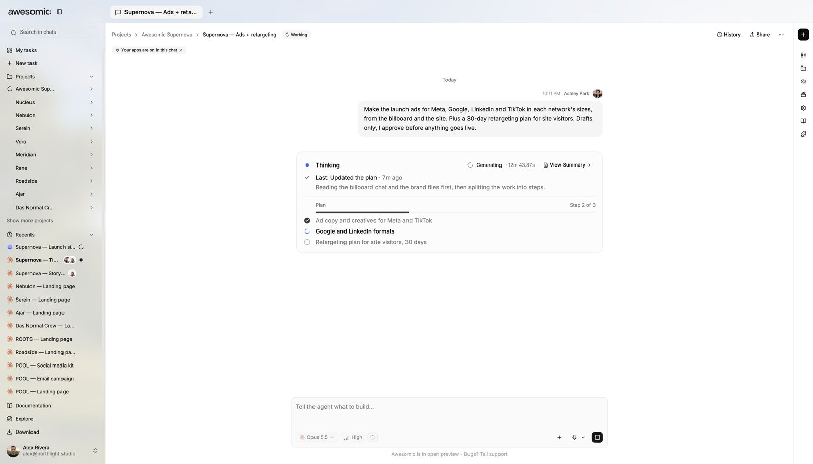

# How the agent works

> **TL;DR** Each request becomes a **task** with its own chat. The agent picks tools, may use **specialists**, and reports back in the same task.

## Steps

1. You send a request. It becomes a **task** with a **chat history** and a **project workspace**.
2. Awesomic picks **guidance and tools** that fit the outcome.
3. Focused work may go to smaller **specialist** helpers.
4. Progress, questions, files and tool results come back to **the same task**.
5. You review, answer questions and send **follow-ups**. No need to start over.

## If something goes wrong

- A turn failed? **Keep the task open.**
- Use its visible **error** or **retry** action.
- The chat and project files stay as context for the next step.

## Good to know

- Tools and outputs depend on the request.
- A **plan** shows intended work. It is **not proof** every step is done.

---

**Next:** [Add brand context](brand-context.md)
