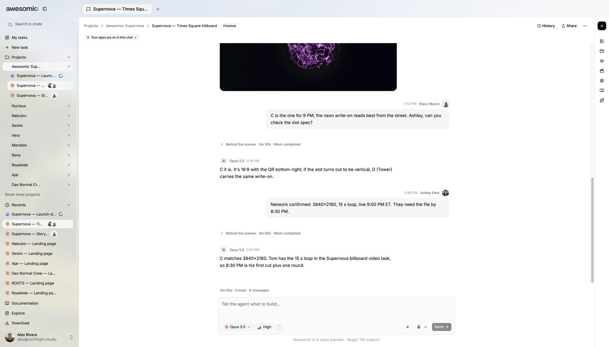

# Sharing and guest access

> **TL;DR** Share a project or output with **only the people who need it**, with only the access they need.

## Steps

1. Open the **project**, **preview** or **published output**.
2. Choose the **share** or **guest** action.
3. Check the **access scope** before you copy the link.
4. Send the link **only** to the right people.
5. **Remove** or change access when the work is done.

## What you get

- The person can **review**. Editing and private project access stay **separate**.

## If they cannot open it

- Check the **target** and **permission**.
- Do **not** make a broader public link instead.

## Good to know

- A **public link** does not give **edit access** to the project.
- Keep **private material** out of public outputs.

---

**Next:** [Skills](skills.md)
